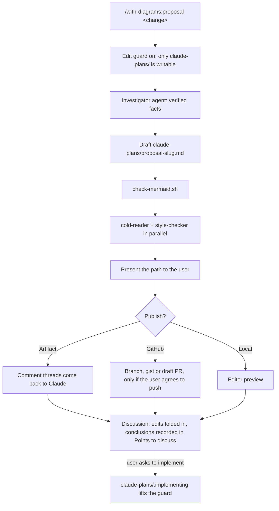

# RSE plugins

This repo is a collection of plugins, also called a  **marketplace**. "RSE" in the name stands for "Research Software Engineering". The marketplace collects Claude plugins that may useful in software development for research.

## Plugins, skills and subagents
A **plugin** is a package that bundles skills that share some resources (e.g. subagents) and install, update and switch on or off together. 

**Skills** can be exposed to the user or not. A useful way to frame this can be:
- user-invocable skills represent a *workflow*, as a set of instructions the main Claude follows itself, in the conversation that triggers the skill. 
- non-user-invocable skills represent a packet of *know-how* (e.g. this is how we write proposals), that the main Claude or subagents can access.

An agent (or **subagent** here) is a separate worker the main Claude can delegate to. The two often pair well in one plugin. E.g.: a skill can describe a workflow that includes “hand the draft to the fact-checker agent” as one of its steps. Users do not need to trigger this delegation: it is defined in the corresponding skill.


## Installation
To install all the plugins in this marketplace....
From a local clone:
....

From Claude code:
```
/plugin marketplace add ...
```


## The `with-diagrams` plugin

Currently, the marketplace in this repo holds a single plugin (`with-diagrams`). 

The `with-diagrams` plugin produces markdown documents that are meant to be read by humans and try to transmit information mostly visually. 

At the moment, the plugin only contains one workflow, captured in the skill called `proposal`. The plan is to further expand the plugin to include other workflows that can benefit from visual summaries (e.g. to provide an overview of an AI-generated PR that needs review).

A user can trigger a workflow under a plugin explicitly using semicolon notation (e.g. `with-diagrams:proposal`). They can also be called by the main Claude agent directly when the context matches the skill's `when_to_use` description. 


### User workflow

1. **Describe** a desired feature to Claude and prompt it to draft a proposal.
    - If you want to be explicit, you can trigger it with `/with-diagrams:proposal`.

2. The main Claude agent will follow the workflow described in the `proposal` skill, delegating to subagents when necessary, and **produce a proposal markdown file** with diagrams, code snippets, bullet-point lists and collapsible sections. 
    - The goal is to transmit clearly a detailed implementation of a feature while avoiding dense prose, providing more details gradually, and using visual communication where possible and relevant.
    - The proposal will be added to a `claude-plans` subdirectory, under the current directory.

3. Once the proposal is ready, start a new Claude conversation, and ask questions and clarifications about the proposal by selecting specific sections of it. 
    - Claude will clarify and edit the proposal where it is confusing, and make any requested changes.
    - In the "Points to discuss" section, you can add your conclusions that you want the agent to take into account when implementing.
    - Feel free to make edits on the proposal yourself, to make the description of the implementation as clear as possible to future you or others. I find that by rephrasing some of the sections and checking with Claude if I understood correctly I often get a better understanding.

4. Once you are happy with the proposal and feel like you have a clear idea of how the feature, ask Claude to implement it and open a draft PR.
    - I usually ask for Claude to do the implementation in the same branch that holds the proposal. This way the proposal is kept in the PR history.
    - After implementing the PR, the proposal is deleted (but will remain in the PR history for reference).
    -  You can also explicitly request for the PR description to follow the repo's template and style.
    - I also often ask for it to make small self-contained commits, that hold closely related changes and that I can review one by one.


### Agentic workflow

When the `proposal` workflow is triggered, this is what is happening under the hood:

1. An edit guard is enables, that makes only `claude-plans` writable (not strictly enforced). 
    - This is because during the drafting of the proposal, we do not want code to be edited.

2. The main Claude agent delegates to an `investigator` agent, that collects relevant facts for the proposal and reports back to the main agent.

3. Using the gathered information, the main agent generated a draft proposal.

4. The draft proposal is then checked in three ways:
    - First, we check that the mermaid diagrams render correctly with a bash script.
    - Then, it is passed to two subagents:
        - One of them checks the style matches the guidelines under `writing-style`
        - Another one acts as a cold-reader and checks for confusing points.

5. The main Claude agent receives the review reports and makes the necessary edits (ok?) 

6. After the final edits, the proposal is presented to the user for discussion.

7. To discuss the proposal, (how to trigger the interactive)




Solid arrows show the order of the steps; edge labels name the branch taken.

The edit guard is a `PreToolUse` hook in the `proposal` skill's frontmatter:

- It refuses Edit, Write, MultiEdit and NotebookEdit on project files outside `claude-plans/`.
- Skill hooks stay registered for the rest of the session, so the guard steps aside once `claude-plans/.implementing` exists. Claude creates that file only when the user explicitly asks to implement.
- It does not cover Bash, which is held to the same rule only by the skill's instructions.
- It needs `jq` on `PATH`.

It needs jq. macOS includes it at /usr/bin/jq. Without it, the hook allows everything.

In your repo, you may want to gitignore claude-plans/.implementing.


## Notes for developers
* Files a skill reads should live inside that skill's folder. Claude resolves paths in SKILL.md relative to the skill directory

### Develop with live edits

Load the plugin straight from this repo, so Claude Code reads your working copy instead of an installed one.

1. **Load the plugin folder** in a new session. Use one of these:
    - Terminal:

        ```bash
        claude --plugin-dir /path/to/rse-plugins/with-diagrams
        ```

    - VS Code, or anywhere you can't pass a flag: add the folder to your *user* settings, `~/.claude/settings.json`, then open a new session. Project settings can't set this variable.

        ```json
        { "env": { "CLAUDE_CODE_PLUGIN_DIRS": "/path/to/rse-plugins/with-diagrams" } }
        ```

    Pointing either option at `rse-plugins/` instead loads every plugin folder in it.

2. **Check that it loaded.** `/with-diagrams:proposal` should autocomplete, and `/plugin` lists the plugin under **Installed**. Load errors appear under **Errors**.

3. **Edit the files**, then run `/reload-plugins` in the session to apply the changes.

4. **Re-run the skill after editing its frontmatter.** Skill hooks are registered when the skill runs, so run `/with-diagrams:proposal` again, then check `/hooks`.

5. **Validate before committing**:

    ```bash
    claude plugin validate ./with-diagrams   # plugin manifest and skill/agent frontmatter
    claude plugin validate .                 # marketplace manifest
    ```

6. **To check the diagrams render**:

    ```bash
    with-diagrams/skills/proposal/scripts/check-mermaid.sh README.md
    ```

    It needs `mmdc` or Node.js (`npx`). On first use, also install the headless browser that mermaid-cli renders with: `npx puppeteer browsers install chrome-headless-shell`.

Don't also install the plugin from the marketplace while developing. Two plugins with the same name would be loaded.

### Release a change

An installed copy is pinned to `version` in [plugin.json](with-diagrams/.claude-plugin/plugin.json). Users only get a change once that version is bumped:

1. Bump `version` in `with-diagrams/.claude-plugin/plugin.json`.
2. Validate, as in step 5 above, and push.
3. Users update with `/plugin marketplace update rse-plugins`.

### To test the edit guard while drafting the proposal

The `proposal` skill's hook blocks edits outside `claude-plans/` until `claude-plans/.implementing` exists. To check it:

1. Run `/with-diagrams:proposal <some change>`.
2. Ask Claude to edit a source file. The edit should be refused, with a message naming `with-diagrams:proposal`.
3. Ask Claude to implement. It should create `claude-plans/.implementing`, after which edits go through.

If the hook never fires, check `/hooks` and the debug log. The hook needs `jq` on `PATH`. macOS includes it at /usr/bin/jq. Without it, the hook allows everything.


## Inspo
* https://github.com/timholy/claude_config/tree/main
* https://github.com/erlichlab/delab-skills