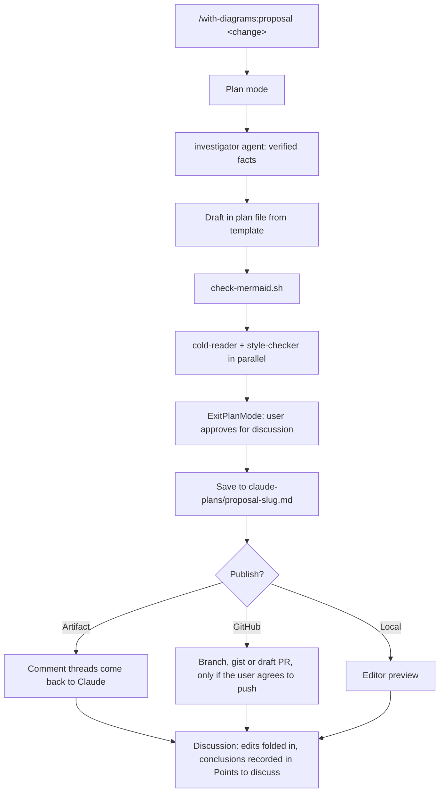

# RSE plugins

This repo is a **marketplace** (or a collection of plugins) called `rse-plugins`, where RSE stands for "Research Software Engineering". It collects Claude plugins that may useful in software development for research.

## Plugins, skills and subagents
A **plugin** is a package that bundles a collection of skills that share some resources (e.g. subagents) and they install, update and switch on or off together. 

**Skills** can be exposed to the user or not. A useful way to frame this can be:
- user-invocable skills represent a *workflow*, as a set of instructions the main Claude follows itself, in the conversation that triggers the skill. 
- non-user-invocable skills represent a packet of know-how (e.g. this is how we write proposals), that the main Claude or subagents can access.

An agent (or **subagent** here) is a separate worker the main Claude can delegate to. The two often pair well in one plugin. E.g.: skill can describe a workflow that includes “hand the draft to the fact-checker agent” as one of its steps. Users do not need to trigger this delegation: it is defined in the corresponding skill.


## `with-diagrams` plugin

Currently, the marketplace in this repo holds a single plugin: `with-diagrams`.

The `with-diagrams` plugin produces markdown documents that try to transmit information mostly visually. At the moment, it only contains one skill called `proposal`. The plan is to further expand it to include other "workflows" that could benefit from visual summaries (e.g. to provide an overview of an AI-generated PR that needs review).

A user can trigger the skills under a plugin explicitly using semicolon notation (e.g. `with-diagrams:proposal`). They can also be called by the main Claude agent directly when the context matches the skill's `when_to_use` description. 


## Installation
From Claude code:
```
/plugin marketplace add ...
```


## Agentic workflow
plan mode → investigate → draft → check → review → present → save → discuss


## Agentic workflow




## Notes for developers
* Files a skill reads should live inside that skill's folder. Claude resolves paths in SKILL.md relative to the skill directory


## Inspo
* https://github.com/timholy/claude_config/tree/main
* https://github.com/erlichlab/delab-skills