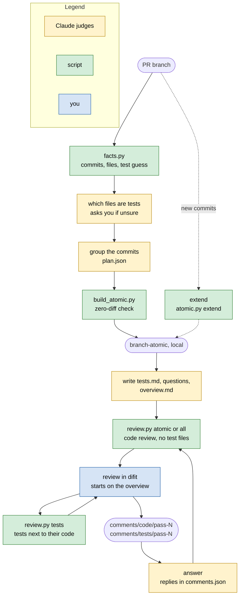

# pr-review-lite

Review a large PR in [difit](https://github.com/yoshiko-pg/difit), one atomic commit at a time. The review works like GitHub's, with two changes:

- **Atomic commits.** Claude rebuilds the branch as a local `<branch>-atomic` copy. Its commits each do one thing and end with the same files as the PR. The PR branch is never touched.
- **Code and tests apart.** The code review hides test files. The tests review shows each test next to the code it tests.

Every run is a new **pass**, saved to `pr-review/comments/<code|tests>/pass-N/comments.json`. Preloaded questions appear as open threads.

## Needs

- [uv](https://docs.astral.sh/uv/getting-started/installation/)
- difit, installed with `npm i -g difit@5.0.12`
- [gh](https://cli.github.com) (optional), for a PR given by number

## Commands

Run these from inside the reviewed repo:

| Command | Does |
|---|---|
| `/pr-review-lite [branch or PR]` | Builds the atomic branch, asks which files are tests if unsure, and opens the code review with `difit`, one commit at a time |
| `/pr-review-lite all` | Code review of the whole PR at once |
| `/pr-review-lite tests` | Tests review |
| `… --pass N` | Adds comments to pass N instead of starting a new one |
| `… --with-tests` | Shows the test files in the code review too |
| `… --no-questions` | Starts the pass without the preloaded AI-suggested questions |
| `/pr-review-lite answer` | Claude replies to the open threads from the most recent pass, in the comments file |
| `/pr-review-lite extend` | Adds new commits of the PR branch to the atomic branch |

To stop a review, use the page's **Stop** button. 

On a thread:

- **Resolve** closes it, and marks it as reviewed in the comments file.
- A reply of `delete` deletes it.

## Files in `pr-review/`

The folder is ignored locally, so it is never committed.

| File | Holds |
|---|---|
| `overview.md` | Before and after the PR, plus one diagram. The review page opens on it |
| `tests.md` | The steps of the tests review, with each file tagged `code:` or `test:`. The `test:` files are left out of the code review. Edit the tags to move a file between the two reviews |
| `questions-code.json`, `questions-tests.json` | The preloaded questions |
| `comments/` | One `comments.json` per pass |

## Under the hood

Rounded boxes are what the steps make. Dotted arrows: when the PR branch gains commits. If `<branch>-atomic` exists, a run skips straight to the review.
