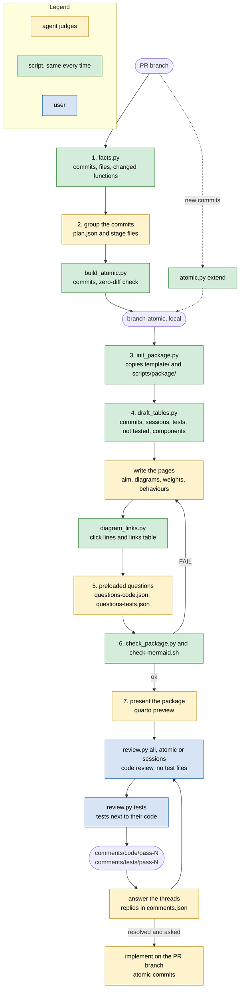

# pr-review

A Claude Code skill that builds a review package for a large pull request: the aim and diagrams, an atomic copy of the branch, and two reviews in difit (code, then tests) with preloaded questions. It maps and indexes the PR; the reviewer judges the code.

Start it with `/pr-review [branch, PR number or URL]`, from inside the reviewed repo.

## How it runs

Arrows are steps in order, numbered as in [SKILL.md](SKILL.md). Rounded boxes are what the steps make. Dotted arrows: when the PR branch gains commits.

## Files

| Path | Holds | Read or run by |
|---|---|---|
| [`SKILL.md`](SKILL.md) | The steps | The agent, at the start |
| [`DECISIONS.md`](DECISIONS.md) | Why each choice was made | The agent, when a rule seems arbitrary |
| [`MAINTAINING.md`](MAINTAINING.md) | difit and Quarto facts, traps, ideas not done | Whoever changes the fixed files |
| [`example/`](example/README.md) | The pages written for one real PR | The agent, as the model for each page |
| [`template/`](template/) | The Quarto page | `init_package.py`, copied into each package |
| [`scripts/package/`](scripts/package/) | The difit scripts: `review.py`, `atomic.py`, … | `init_package.py`, copied into each package; the reviewer runs `review.py` |
| [`scripts/`](scripts/) | `facts.py`, `build_atomic.py`, `init_package.py`, `draft_tables.py`, `diagram_links.py`, `check_package.py` | The agent |
