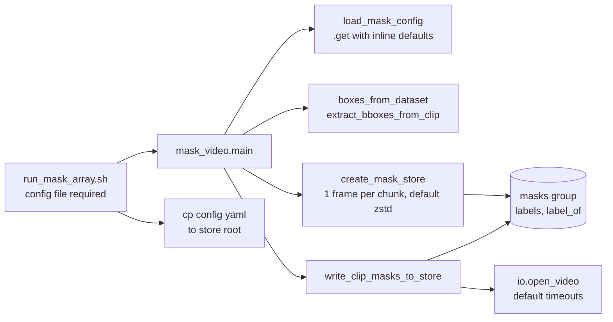
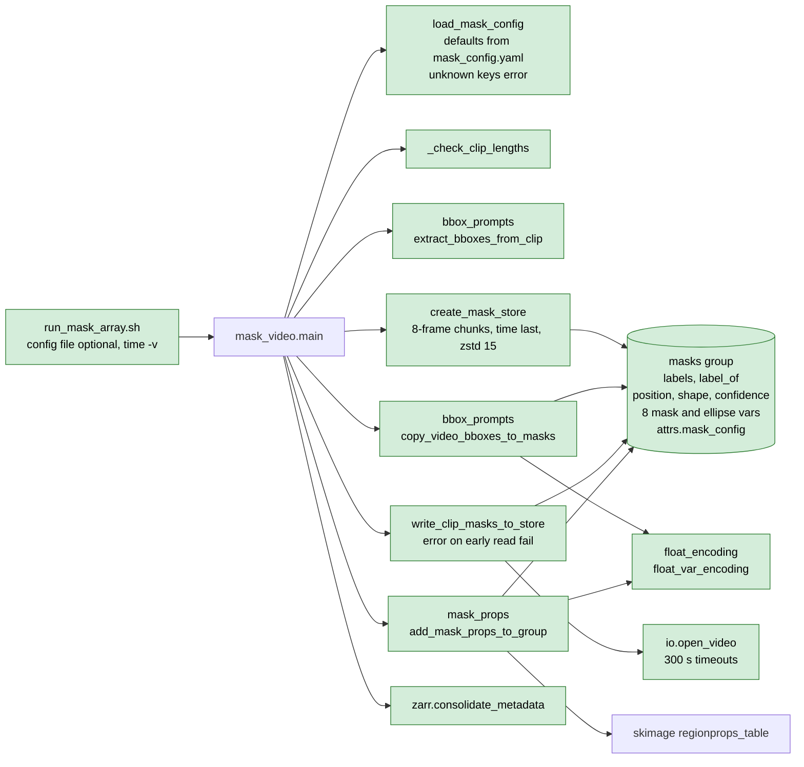

#  Aim

## Aim

**Before this PR**: the masks store from `mask-tracked-crabs` held only the mask labels. Also: cluster runs needed a config file, wrote one frame per chunk, ignored unknown config keys, and copied the config YAML next to the store.

**With this PR**: the masks store now also holds the bounding boxes used as prompts, and 8 shape parameters (from the ellipse fitted to each mask) for every frame. These use the same `(clip_id, time, individual)` dimensions as the trajectories store. Cluster runs also use less disk space, stop with an error on bad video inputs, and save their config inside the store (`attrs.mask_config`).

## Components: before → after

Green = new or changed. Grey = unchanged. Each box names a real file or function.

### Before (`d005d99`)

### After (`1b9c04f`)

