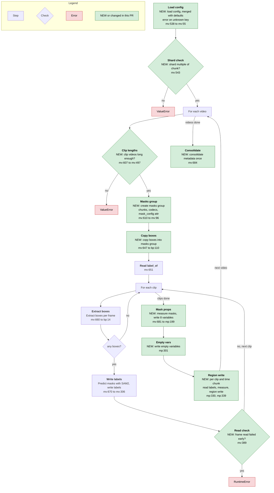
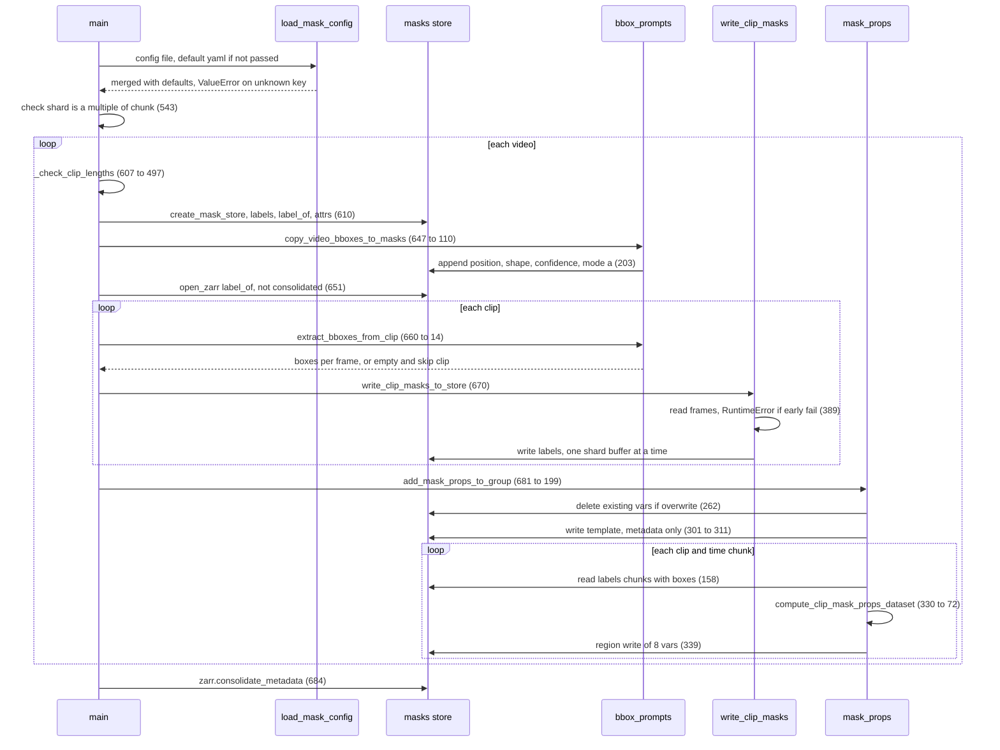

# Workflow

This file shows two types of diagrams to describe the changes in this PR:

* [Flow diagram](#flow-diagram)
* [Sequence diagram](#sequence-diagram-same-path)

## Flow diagram
[↑ Back to top](#top)

* `mv` = `crabs/mask/mask_video.py`
* `bp` = `crabs/mask/utils/bbox_prompts.py`
* `mp` = `crabs/mask/mask_props.py`

Numbers are line numbers. "a to b" means the call site, then the definition.

Click a box to open its code on GitHub, pinned to commit `1b9c04f`. If clicks do not work in your viewer, use the table below the diagram.

Links to code for each box

| Step | Code |
|---|---|
| **Load config**: Load config, merged with defaults | [mv:538](../../crabs/mask/mask_video.py#L538), [mv:55](../../crabs/mask/mask_video.py#L55) |
| **Shard check**: Shard multiple of chunk? | [mv:543](../../crabs/mask/mask_video.py#L543) |
| **Clip lengths**: Clip videos long enough? | [mv:607](../../crabs/mask/mask_video.py#L607), [mv:497](../../crabs/mask/mask_video.py#L497) |
| **Masks group**: Create masks group | [mv:610](../../crabs/mask/mask_video.py#L610), [mv:96](../../crabs/mask/mask_video.py#L96) |
| **Copy boxes**: Copy boxes into masks group | [mv:647](../../crabs/mask/mask_video.py#L647), [bp:110](../../crabs/mask/utils/bbox_prompts.py#L110) |
| **Read label_of** | [mv:651](../../crabs/mask/mask_video.py#L651) |
| **Extract boxes**: Extract boxes per frame | [mv:660](../../crabs/mask/mask_video.py#L660), [bp:14](../../crabs/mask/utils/bbox_prompts.py#L14) |
| **Write labels**: Predict masks, write labels | [mv:670](../../crabs/mask/mask_video.py#L670), [mv:306](../../crabs/mask/mask_video.py#L306) |
| **Read check**: Frame read failed early? | [mv:389](../../crabs/mask/mask_video.py#L389) |
| **Mask props**: Measure masks, write 8 variables | [mv:681](../../crabs/mask/mask_video.py#L681), [mp:199](../../crabs/mask/mask_props.py#L199) |
| **Empty vars**: Write empty variables | [mp:301](../../crabs/mask/mask_props.py#L301) |
| **Region write**: Read labels, measure, region write | [mp:330](../../crabs/mask/mask_props.py#L330), [mp:339](../../crabs/mask/mask_props.py#L339) |
| **Consolidate**: Consolidate metadata once | [mv:684](../../crabs/mask/mask_video.py#L684) |

## Sequence diagram (same path)
[↑ Back to top](#top)

Each column is a component. Arrows are calls between them, in time order, top to bottom.

| Participant | Location |
|---|---|
| main | `crabs/mask/mask_video.py:526` |
| load_mask_config | `crabs/mask/mask_video.py:55` |
| bbox_prompts | `crabs/mask/utils/bbox_prompts.py` |
| write_clip_masks | `crabs/mask/mask_video.py:306` |
| mask_props | `crabs/mask/mask_props.py` |

Numbers in brackets are line numbers. "a to b" means the call site, then the definition.
