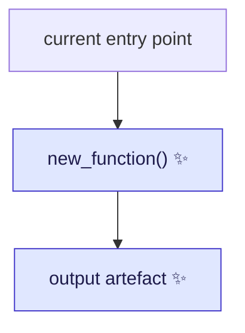
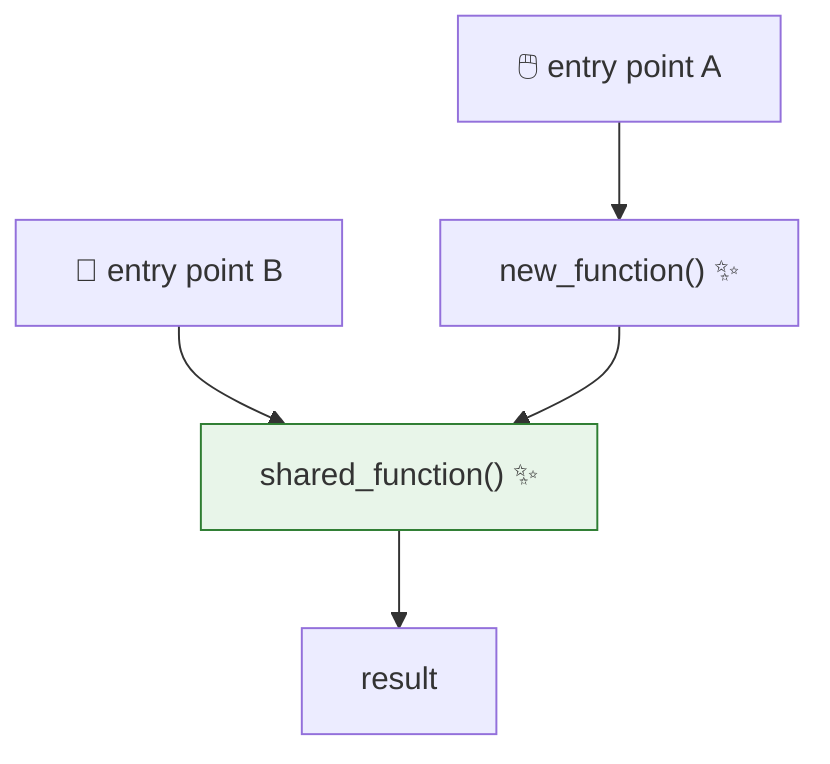

# Proposal for <what this changes>

## Description

<One or two lines: what this PR adds or changes, why is it needed.>

<A second line only if the first cannot carry it.>



Arrows are <sequential steps / parent-to-child relationships>. ✨ marks what is new in this PR.

| Box | Code |
|---|---|
| `current entry point` | [file.py:56](path/to/file.py#L56) |
| `new_function()` ✨ | **new** — `path/to/new.py` |

> [!NOTE]
> **Term.** One-line definition of any word a newcomer would not know.

## References

* Issue [#NNN](https://github.com/<org>/<repo>/issues/NNN) — <what it asks for>.
* PR [#MMM](https://github.com/<org>/<repo>/pull/MMM) — <how it overlaps>.
* [`related-plan.md`](related-plan.md) — <which part of it this is a slice of>.

## Overview of steps

1. <Step, in one line.>
2. <Step, in one line.>
3. <Step, in one line.>
4. <Step, in one line.>

## Key aspects of suggested implementation

### 1. <The external constraint that shapes everything else>

<One line: what the framework, format or API requires.>

<Then the snippet that shows it.>

```yaml
# path/to/manifest.yaml
    # ------ new entry ------
    - id: ...
    # -----------------------
```

```python
def the_hook(path: str | list[str]) -> Callable | None:
    """One line saying what it returns and when it declines."""
```

### 2. <The second thing a reviewer must agree with>

<One line: what this decides.>

* `thing_a` — what it does.
    * why it cannot be expressed the new way.
* `thing_b` — what it does.
    * why it can.

The options considered:

* **<Option A>** ✅ chosen — <one line why>.
* **<Option B>** — <one line why not>.

<details>
<summary>Table: per <item> details</summary>

| item | needs X? |
|---|---|
| `name` | **Yes** — because … |
| `name` | No — because … |

</details>

## Detailed implementation

<One line on what the paths converge on.>



Arrows are <sequential steps / parent-to-child relationships>.

### The N changes

<table>
<thead>
<tr><th>#</th><th>Change</th><th>Signature / diff</th></tr>
</thead>
<tbody>

<tr>
<td>1</td>
<td>

**Short title in bold** — the one-line reason

</td>
<td>

```python
# new path/to/file.py
def new_function(...) -> ReturnType: ...
```

</td>
</tr>

</tbody>
</table>

### Steps in detail

<details>
<summary><b>Step 1 — <title></b></summary>

**Why.** <The problem this step solves, in one line.>

**What moves where:**

| from | what |
|---|---|
| `old_place` ([:12-30](path/to/file.py#L12-L30)) | the part that moves |

**Alternatives rejected:**

| alternative | why worse |
|---|---|
| <option> | <reason> |

</details>

## Files changed

| File | Change |
|---|---|
| `path/to/new.py` | **new** — `function_a`, `function_b` |
| [`path/to/existing.py`](path/to/existing.py) | <what changes> |
| `tests/.../test_new.py` | **new** |

Nothing else is touched. In particular: <the files a reviewer would expect to change and which do not>.

## Tests

<One line: yes, tests are needed / no, and why not.>

**Unit**

1. **<What it pins.>**

   ```python
   # assert the property, not the implementation
   assert to_label_image(planes).max() == 12
   ```

2. **<What it pins.>**, reusing the `<fixture>` fixture ([tests/fixtures/x.py](tests/fixtures/x.py)).

**Integration**

3. **<The full round trip.>**

   ```python
   RUN the entry point on the 3-frame clip
   ASSERT the artefact exists and has shape (3, M, H, W)
   ```

## Documentation updates

<One line: yes / no.>

| File | Change |
|---|---|
| [`docs/source/...`](docs/source/) | document <feature> |

## Verifications for agent to run

* **Manual**: <what to do by hand, and how to get the data for it>.

```bash
pytest <paths>
pre-commit run --all-files
```

## Points to discuss

| # | To discuss | Conclusion |
|---|---|---|
| 1 | **<Question in bold>.** <Context in one line, then the question.> My recommendation: <one line>. | |
| 2 | **<Trade-off>.** <What is at stake either way.> | |
| 3 | **Potential follow-up: <thing>.** <Why it is out of scope here, and what it would take.> | |
